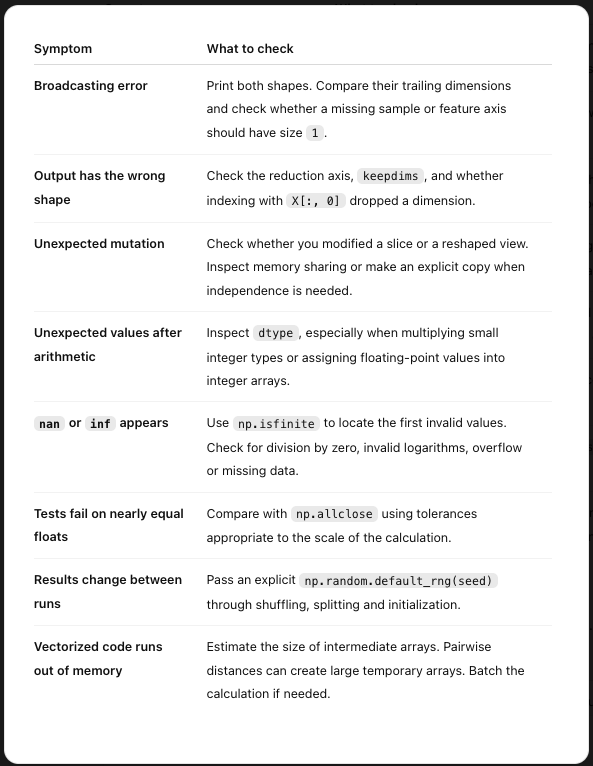
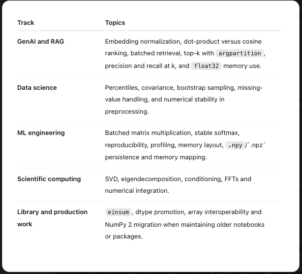

# Python Library Numpy
## NumPy Roadmap for Data Science and Machine Learning
Learn NumPy in this order: arrays and shapes → indexing and masking → axes and broadcasting → numerical computing → ML implementation → performance. For your AI/ML goals, prioritize the skills you’ll reuse in Pandas, scikit-learn and PyTorch: understanding shapes, transforming data, computing metrics and debugging numerical results.

# 1. Contents: 
### 1.1 Array fundamentals:
 `ndarray`, dimensions, `shape`, `ndim`, `size`, `dtype`, `itemsize`, `nbytes`. Create arrays with `array`, `asarray`, `zeros`, `ones`, `full`, `arange`, `linspace`, `eye`. Learn `astype` and integer versus floating-point types.

### 1.2 Indexing and reshaping: 
Positive and negative indexing, slicing, boolean masks, integer indexing, `where`, `nonzero`, `reshape`, `expand_dims`, `squeeze`, `transpose`, `ravel`, `flatten`, `concatenate`, `stack`, `split`. 

### 1.3 Vectorization and broadcasting:
Elementwise operations, universal functions such as `sqrt`, `exp`, `log` and `clip`, broadcasting rules, `axis`, `keepdims`, conditional calculations and pairwise operations.

### 1.4 Statistics and data preparation:
`sum`, `mean`, `median`, `std`, `var`, `percentile`, `quantile`, `argmax`, `argsort`, `unique`, `bincount`, `histogram`, `corrcoef`, `isnan`, `isfinite`, `nanmean`. Learn missing values, outlier summaries and train/test leakage. | Build a NumPy preprocessing pipeline that imputes and scales numeric features using statistics learned from the training set.

### 1.5 Linear algebra: 
Vectors and matrices, `@`, `dot`, transposes, norms, distances, cosine similarity, `np.linalg.solve`, `lstsq`, eigenvalues and SVD. | Fit linear regression using least squares. Compute cosine similarity between a query embedding and several document embeddings. |

### 1.6 Randomness and numerical correctness:
 `default_rng`, sampling, shuffling, permutations, normal and uniform distributions, sampling with replacement, `float32` versus `float64`, overflow, `isclose`, `allclose`, and `errstate`. | Create a reproducible train/test split. Implement stable softmax and verify it on large input values.

### 1.7 ML from scratch:
 Loss functions, gradients, vectorized predictions, mini-batches, metrics and convergence checks. | Implement linear regression with gradient descent, then pick **K-means** or **logistic regression**. Compare the results with scikit-learn on the same split.

# 2. Core concepts to learn in depth
### 2.1 Shapes and axes
### For a tabular dataset X with shape (n_samples, n_features):
 
=> `X.mean(axis=0)`, `(n_features,)` : One mean per feature. Reduces the sample axis.

=> `X.mean(axis=1)`, `(n_samples,)` : One mean per sample. Reduces the feature axis. 

=> `X.mean(axis=0, keepdims=True)` : `(1, n_features)` | Keeps the reduced axis as a size-1 dimension.

=> `X[:, 0]`, `(n_samples,)` : Selects the first feature as a 1-D array.

=> `X[:, :1]`, `(n_samples, 1)` : Selects the first feature and preserves the column axis.

# 3. Projects in build order:

# 4. Debugging checklist:

# 5. Advanced topics by specialization:
After the core roadmap, choose the topics that match what you’re building.

You’re ready to use NumPy independently when you can predict array shapes, explain when a slice shares memory, build preprocessing without leakage, reproduce a result with a seeded generator, and verify a NumPy implementation against a reference.

### Reference Links: 
https://numpy.org/doc/stable/
